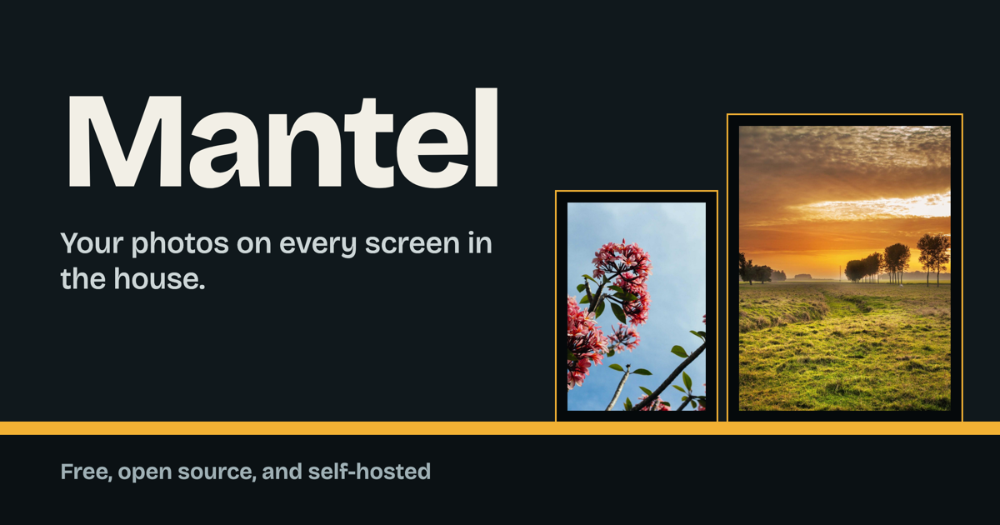

# OpenMantel

[OpenMantel](https://openmantel.com) is a free, open source digital picture frame that you host yourself. Put a small computer behind a monitor, point it at your server, and your photos are on display.

Store-bought frames do much the same, but they often lock you into an app, a subscription, or someone else's cloud. OpenMantel runs on a small VPS or a homelab server. Your photos stay on your own server, there are no sign-ups and no tracking, and the app makes no outside requests.

OpenMantel is part of the [metaincognita](https://metaincognita.com) collection of simulations and tools. It doesn't depend on any of them.

## What it does

- **Pairs like a TV streaming stick.** A new frame shows a code. Enter it on your phone and the frame is set up for good, with no keyboard and no password on the frame.
- **Works as a remote.** From your phone, start a slideshow on every frame or just one, leaving the others as they are. Skip, go back, pause, or send any photo to a frame. Change what a frame shows, its matte color, timing, captions, and sleep hours, or schedule a preset for certain days and times. Frames update immediately. Add the admin to your home screen and it opens like an app.
- **Never crops.** Portrait, square, and panoramic photos always show in full, on a matte or a blurred backdrop, with optional captions.
- **Plays forever, in your choice of order.** Slideshows start again after the last photo. In random order, each pass is reshuffled. In sequence, they follow the order you arranged, or the playlist's order.
- **Organizes by tag.** Upload in batches, tag photos, save presets such as "Holidays", and search by file name or caption. Arrange photos by dragging, or on a phone by tapping a photo and then tapping where it goes.
- **Builds playlists.** Drag photos from your library into a playlist such as "Kitchen", in the order you want. Give each frame its own playlist, or share one between frames. A playlist isn't tied to a frame, so it survives moving a frame to another room.
- **Brings back memories.** Show photos taken on today's date in past years, on a frame or in a slideshow.
- **Keeps playing offline.** Each frame keeps a copy of the photos it has shown or fetched ahead, so it carries on without a network, even after a restart.
- **Handles iPhone photos.** Upload straight from your phone: open the admin in Safari, tap the upload area, and choose **Photo Library**. HEIC files work, photos are rotated correctly, and location data is stripped from everything a frame receives.
- **Plays anywhere you're logged in.** Any browser where you're logged in can run a full-screen slideshow, with no pairing.
- **Shows what's in each photo.** The ⋮ button on any photo shows its original format, file size, compression, colour profile, camera and lens settings, location if the camera recorded one, and the frame images made from it.
- **Stays yours.** Download every original, with its tags and captions, at any time. The Stats page shows server health and roughly how many more photos will fit, and the Technical details page shows the exact version running.

## Self-hosting

You need a server with Docker Compose, a domain name pointing at it, and ports 80 and 443 open. HTTPS is required, and the included Caddy setup gets the certificate for you.

```bash
git clone https://github.com/cschweda/openmantel.git
cd openmantel
cp .env.example .env && chmod 600 .env
```

Set `DOMAIN` in `.env`, then create the admin password. It must be at least 12 characters.

```bash
docker compose run --rm app node_modules/.bin/tsx scripts/hash-password.ts
```

Paste the line it prints into `.env`, in place of the empty `NUXT_ADMIN_PASSWORD_HASH=` line, and start OpenMantel:

```bash
docker compose up -d
```

Open `https://your-domain/login` to sign in. With Docker, a database snapshot is taken every day and kept for 14 days.

The [self-hosting guide](docs/self-hosting.md) covers homelab setups, updating, backups and restores, running without Docker under pm2, and troubleshooting.

## Setting up a frame

Any computer with a browser and a monitor can be a frame. To try it, open your site in a browser. To run a frame full time, use the setup script for that machine. It opens the browser full screen at login, restarts it if it crashes, and keeps the screen awake.

```bash
# Mac (needs Google Chrome)
curl -fsSL https://raw.githubusercontent.com/cschweda/openmantel/main/scripts/setup-frame-mac.sh | FRAME_URL=https://your-domain bash
```

On a Mac, add `SLEEP_START=22:30 SLEEP_END=06:30` to turn the monitor off overnight. Scripts for Ubuntu, Windows, and Raspberry Pi are in [`scripts/`](scripts/).

The frame then shows a code. On your phone, log in, choose **Pair a frame**, and enter the code. Check that the screen size and IP address match the frame, give it a name, and approve it.

To retire a frame, or before moving it to another server, press **Deactivate** on its card in **Frames**. It goes back to showing a code, and has to be paired again to show photos.

So far the Mac script has only been dry-run, and the Ubuntu, Windows, and Raspberry Pi scripts haven't been tried on real frames, so reports are welcome. If a frame's disk is encrypted, as on a Mac with FileVault, someone has to log in after a power cut before it shows photos.

## Development

OpenMantel is built with Nuxt 4, Nuxt UI, and TypeScript, on Node 22 with pnpm 12, SQLite, and `sharp`.

```bash
cp .env.example .env && chmod 600 .env
pnpm install
pnpm hash-password    # paste the printed line into .env
pnpm dev              # http://localhost:3100
```

In development, log in with Chrome or Firefox. The session cookie is always `Secure`, and Safari refuses those over plain `http://localhost`.

| Command | What it does |
|---|---|
| `pnpm test` | Runs the API tests against a throwaway database. Run `pnpm build` first. |
| `pnpm typecheck` | Checks types. |
| `pnpm hash-password` | Prints an argon2id password hash for `.env`. |
| `pnpm photos:compress` | Reports how much large originals would shrink. Add `--apply` to replace them, which can't be undone. |
| `pnpm photos:rebuild` | Recreates missing frame images from the originals. Add `--all` to recreate all of them. |
| `pnpm seed:fetch` | Downloads 50 sample photos into `seed/photos/`. |
| `pnpm seed:ingest` | Uploads the sample photos. Needs the app running and `OPENMANTEL_PASSWORD` set. |
| `pnpm seed:device` | Adds a test device named `test` and prints its token. Add `--remove` to delete it. |

The design is described in [docs/00-master-design.md](docs/00-master-design.md), and the threat model in [docs/06-security.md](docs/06-security.md). Changes are listed in the [changelog](CHANGELOG.md). To report a security problem, see [SECURITY.md](SECURITY.md).

The sample photos come from [Lorem Picsum](https://picsum.photos), which sources them from Unsplash.

## Security audits

Every red/blue team audit is recorded here, newest first. The latest is listed in full. When a new one is added, the one before it is compressed to a summary under **Earlier audits**, so the record is permanent and stays short. Fixes are covered by the `audit …` regression tests in `tests/api.test.ts`. The threat model is in [docs/06-security.md](docs/06-security.md), and problems can be reported as described in [SECURITY.md](SECURITY.md).

### 2026-11-03: Red/blue team audit 1 (latest)

**Scope:** the whole app at commit `7e67c19`, plus deployment files, frame setup scripts, CI, dependencies, git history, and the production server's headers and nginx settings, which were read only.

**Method:** three red teams each attacked a throwaway local copy in one area: logins, sessions and pairing (RA); uploads, images and file serving (RF); and API logic, frames, and infrastructure (RX). Each finding needed a working proof. A separate blue team then tried every attack again on the fixed build, looked for ways around each fix, and checked for regressions. It found one bypass and two regressions, and all three were then fixed. Production was never attacked.

**Result:** 1 High, 4 Medium, 11 Low, and 6 informational findings. All are fixed except the items marked as accepted, or as needing a server change by the owner.

| ID | Finding | Severity | Mitigation |
|---|---|---|---|
| RX-1 | Anyone, without logging in, could send huge request bodies to login and pairing and run the server out of memory | High | Fixed: bodies over 64 KB (256 KB for playlists) are refused before any route reads them, and bodies with no declared length are refused. Only the photo upload, which streams with its own limits, is exempt. Caddy caps bodies too. |
| RX-2 | A frame could store any value, of any size, as the photo it was showing | Medium | Fixed: only the id of a photo that exists is stored. |
| RX-4 | A frame could hold open unlimited live connections, enough to use up nginx's connection limit | Medium | Fixed: at most two per frame; the oldest is closed. |
| RF-1 | No limit on image dimensions, so one huge image could exhaust memory | Medium | Fixed: photos over 100 megapixels are refused from the file header, before decoding. A 48-megapixel iPhone photo is accepted. |
| RF-2 | HEIC photos were decoded with no size check, and the blue team then showed the first check could be bypassed with a file whose header describes a different, smaller image | Medium | Fixed: the decoder checks the size of the image it is about to decode, before allocating any memory for it. |
| RA-1 | The client IP header was believed from anyone, letting someone dodge the per-IP login and pairing limits and fake the IP shown when approving a frame | Low | Fixed: the header is believed only from a proxy on the same machine or a private network. Login has a global limit as well. |
| RA-2 | With RA-1, the 100-pending-pairings cap could be filled to block new frames | Low | Fixed along with RA-1. |
| RX-3 | The admin's browser built an image address from a value the frame supplied | Low | Fixed: checked on the server (RX-2) and in the page. |
| RX-5 | The rate limiter never forgot an address, so a flood of addresses grew memory | Low | Fixed: swept every minute and capped. IPv6 is limited per /64, since one IPv6 host can use 2^64 addresses. |
| RX-6 | A frame could still fetch a photo after it was hidden, by its id | Low | Fixed: hidden photos are refused to frames, through `/v/` and through nginx's optional image check. |
| RX-7 | One admin request could freeze the server with thousands of tag changes | Low | Fixed: at most 100 tags added or removed at a time. |
| RF-3 | An interrupted or rejected upload could leave temporary files on disk | Low | Fixed: a failed upload stops reading at once, and leftovers over an hour old are swept away. |
| RF-4 | Tags sent with an upload skipped the 40-character rule | Low | Fixed: the same checks as the Tags page, and at most 20 tags. |
| RX-9a | `.gitignore` allowed `.env.local` to be committed | Low | Fixed. No secrets were ever committed. |
| RX-9b | GitHub Actions were pinned to version tags that could be moved, while the image workflow can publish to the registry | Low | Fixed: every action is pinned to a commit. |
| OPS-1 | The production nginx config, installed by Laravel Forge, trusts `X-Forwarded-For` from Cloudflare's addresses although the site isn't behind Cloudflare. A request sent through Cloudflare could set its own client IP and undo RA-1 there. It allows 200 MB request bodies on every path, and 768 connections per worker. | Low | Owner action, below. |
| RA-3 | The frame heartbeat doesn't require the CSRF header | Info | Accepted: the frame cookie is `SameSite=Lax`, so other sites can't send it, and a heartbeat only updates that frame's own record. |
| RA-4 | Route checks used the path before `..` segments were resolved. No working bypass was found. | Info | Fixed: paths with dot segments or encoded slashes are refused. |
| RX-8 | Frame setup scripts wrote `FRAME_URL` and sleep times into launch files without checking them | Info | Fixed: only a plain `https://` address and HH:MM times are accepted. |
| RX-9c | The database file was readable by other users on the server | Info | Fixed: the database and its WAL files are created private to the app user. |
| RX-9d | In Docker, the off-site backup failed silently every night because the image has no `rclone` | Info | Fixed: it now fails with a clear message. Install `rclone` on the host, or run the backup from there. |
| RX-9e | Base images aren't pinned by digest, and `pnpm audit` reports four moderate or low issues | Info | Accepted: Dependabot updates the images, and the four advisories are in build tools only, not in what the server runs. |

**Owner action (OPS-1), in the Forge panel for the droplet:**

1. Delete `/etc/nginx/conf.d/cloudflare.conf`, or remove its `real_ip_header` and `set_real_ip_from` lines. The site isn't behind Cloudflare.
2. Set `client_max_body_size 64k;` for the site, with `client_max_body_size 1g;` only in a `location = /api/photos` block, and add `client_body_timeout 30s;`.
3. Raise `worker_connections` to 4096, and consider `limit_req` on `/api/auth/login` and `/api/pair/start`.

**Held up under attack:** CSRF on every admin change; default-deny route checks, including path tricks; frames kept out of admin routes; revoking a frame takes effect at once, including live connections; logout and per-session sign-out; `HttpOnly`, `Secure`, `SameSite=Lax` cookies; fresh session ids at each login; the pairing code design and its replay check; no SQL injection anywhere; no mass assignment; frames can't use the admin preview options; no stack traces in production; location and other metadata stripped from frame images; originals never served; image file names validated; caption, file name and tag text escaped; strict CSP with nonces, HSTS, and TLS 1.3 in production; no secrets in git history.

### Earlier audits

None. This is the first red/blue team audit.

## License

[MIT](LICENSE)
